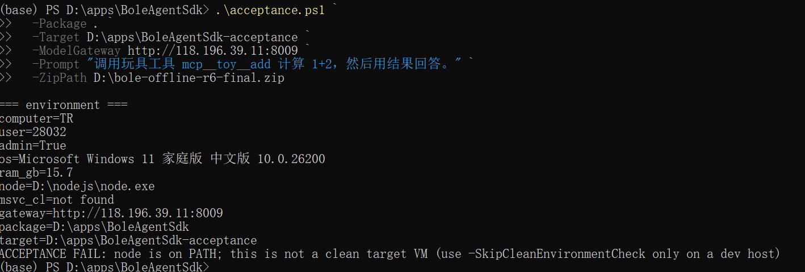
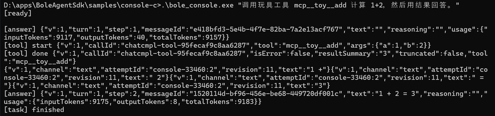
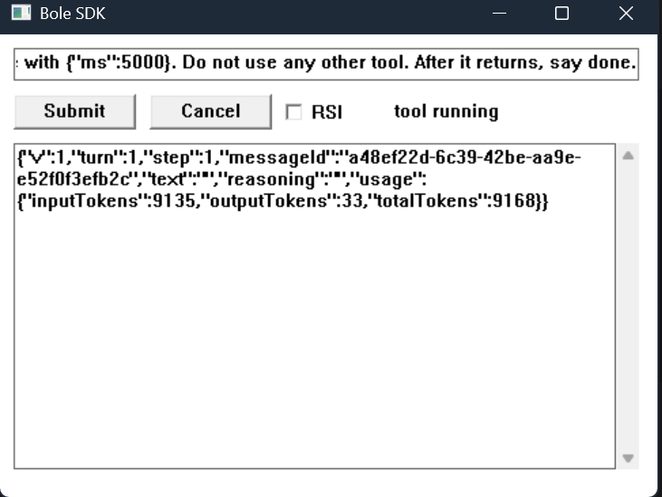
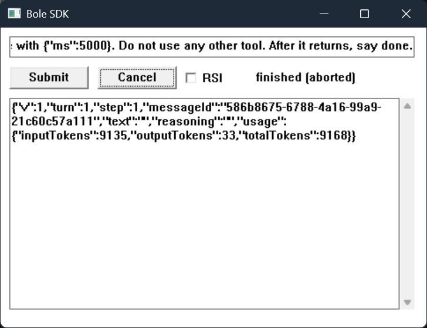
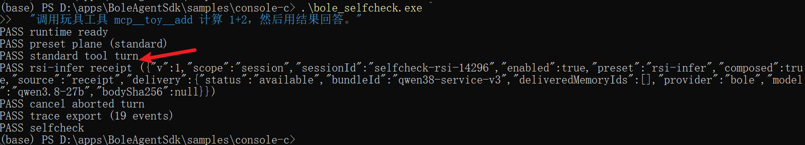

# 伯乐 Agent SDK 交付验收交接报告

> 状态：开发机预验收（非最终 clean VM 验收）  
> 版本：v1.1　日期：2026-10-23　作者：<待填>　接收：产品 / 测试  
> 图片与 `assets/` 目录需和本文一起交付；图注中的编号按第 5 节验收项核对。

## 1. 结论摘要

- 交付物：Windows x64 C SDK + 随包运行时 + 控制台/界面示例 + 离线部署包 + 四份文档。
- 开发机已完成：真实内网网关下的 console 工具调用、B8 自检、GUI 长任务/取消、RSI 开关。
- 开发机 `acceptance.ps1` 在加 `-SkipCleanEnvironmentCheck` 后通过；该参数只用于有 Node 的开发机，干净 VM 不使用。
- 待测试：干净目标 VM、Windows 10（如适用）、Ornith（如现场使用）、EDR/签名、伙伴独立集成。
- 已知限制：验证阶段事件不产生；MCP 仅配置文件声明 + 重启，不支持运行时注册。
- 最终包：`bole-offline-r6-final.zip`
  - SHA256：`aaeeafd8c7e3a520743fd367ce8955b00923a500a453b7d6b604dc1f30dbcc0d`
  - tag：`bole-m0-20261023-r6`
  - 包内 toy MCP：12 个工具；运行时 `0.1.7-alpha.2`；SDK ABI `1.0.0`。

## 2. 交付物清单

| 交付物 | 位置 | 说明 |
| --- | --- | --- |
| SDK 动态库 | `bin/bole_agent.dll` | MSVC x64 `/MT`，仅依赖 `KERNEL32.dll` |
| 导入库/头文件 | `bin/bole_agent.lib`、`bin/bole_agent.h` | C ABI |
| 随包运行时 | `runtime/` | node.exe + dsh 依赖树 + 补丁 |
| 可写运行目录 | `home/` | profile、会话、日志、MCP 配置 |
| 控制台示例 | `samples/console-c/` | `bole_console.exe`、`bole_selfcheck.exe` |
| 界面示例 | `samples/gui-win32/` | 双击即用、多轮、RSI、取消 |
| 玩具 MCP | `tools/toy-mcp/` | 12 个无副作用工具 |
| 交付文档 | `docs/` | 接口、集成、离线部署、错误码 |
| 安装/验收脚本 | 包根 | `install.ps1`、`verify.ps1`、`acceptance.ps1` |

## 3. 环境与前置条件

| 项 | 值 |
| --- | --- |
| 目标 OS | Windows 10 / 11 x64（本次开发机：Windows 11 25H2） |
| 目标机依赖 | 无 Node、无 VS/VC++ 运行库；普通用户 |
| 本次运行账号 | 管理员（开发机）；**干净 VM 需普通用户复核** |
| 模型网关 | `http://118.196.39.11:8009` |
| 模型 ID | `qwen3.8-27b` |
| API key | 无 |
| 网络 | 公司内网；开发机公网探测不可达 |

## 4. 安装与自检

先定义占位符：

| 占位符 | 含义 |
| --- | --- |
| `<package-root>` | 解压后的 `bole-agent-sdk-win-x64` 目录 |
| `<target>` | 第一次安装目录，例如 `D:\apps\BoleAgentSdk`；**不要用解压目录** |
| `<target-2>` | `acceptance.ps1` 专用的**全新**目录，不能已存在 |
| `<gateway>` | 内网网关根地址，例如 `http://118.196.39.11:8009`，不带 `/v1` |
| `<zip>` | 原始 `bole-offline-r6-final.zip` |

```powershell
cd <package-root>

# <target> 是独立安装目录，不是解压出来的 bole-agent-sdk-win-x64 目录
.\install.ps1 -Target <target> -ModelGateway <gateway>

# 与 install 的 -Target 相同
.\verify.ps1 -Root <target>
```

期望：

```text
verify ok
```


然后跑一键验收：

```powershell
cd <package-root>

# 开发机（Node 在 PATH）使用：
.\acceptance.ps1 `
  -Package . `
  -Target <target-2> `
  -ModelGateway <gateway> `
  -Prompt "调用玩具工具 mcp__toy__add 计算 1+2，然后用结果回答。" `
  -ZipPath <zip> `
  -SkipCleanEnvironmentCheck

# 干净 VM：去掉 -SkipCleanEnvironmentCheck
# <target-2> 必须是全新目录，不能已存在
```

期望：

```text
ACCEPTANCE PASS
```



> 注意：这张图是“环境不干净”时的预期拒绝，不能作为最终验收通过证据；最终报告应替换为加参数后的 `ACCEPTANCE PASS` 截图，或由测试团队在干净 VM 上补拍。

## 5. 验收结果对照

| 原任务验收 | 结果 | 证据 |
| --- | --- | --- |
| 1. 无外网/无开发环境，输入→模型→工具→结果 <1 分钟 | 开发机真实网关通过；干净 VM 待测试 | 图 5 console；`ACCEPTANCE PASS` 截图待补 |
| 2. 任务期间界面可交互，取消生效 | 本机通过：sleep 5s 期间 `Responding=True`，Cancel 后 `finished (aborted)` | 图 6 running、图 7 aborted |
| 3. RSI 开关生效且可观测 | 通过；收据 `available`，`bundleId=qwen38-service-v3` | 图 8 GUI RSI + 图 9 selfcheck |
| 4. 按文档独立集成可复现 | 待测试/伙伴 | 四份文档 + 伙伴集成日志 |
| 5. 事件序列与 harness 一致、无伪造 | 通过；验证阶段明确不产生 | 图 9；`selfcheck-trace.jsonl` 截图待补；不伪造 `VERIFY_CHECK` |

> 图 5–9 已按实际截图内容补图注；仍需补一张真正的 `ACCEPTANCE PASS` 截图和一张 `selfcheck-trace.jsonl` 截图（图 4 是 clean 检查拒绝，不能当 PASS）。










## 6. 截图清单（交付前核对）

| 证据 | 当前状态 | 必须展示 |
| --- | --- | --- |
| 包信息 | 待补 | zip 文件名、SHA256、`VERSION.json` |
| 安装 | 已有图 2/3 | `installed to ...`、`verify ok` |
| console | 已有图 5 | `[tool] start`、`mcp__toy__add`、`isError:false`、`resultSummary:3`、`[task] finished` |
| selfcheck | 已有图 9 | B8 全 PASS，含 RSI receipt、cancel、trace |
| GUI 结果 | 待补 | 输入、Submit、结果 |
| GUI running | 已有图 6 | `tool running`，窗口可操作 |
| GUI aborted | 已有图 7 | `finished (aborted)` |
| acceptance | **待补** | `ACCEPTANCE PASS` + evidence 路径；图 4 是拒绝，不能替代 |
| trace | 待补 | `selfcheck-trace.jsonl` 行数/片段 |

截图要求：

- 保留窗口标题、时间、命令，能对应本次包；
- 不要截 API key；网关地址是否打码按公司要求；
- 图片放 `assets/`，与本文一起交付；
- 图 4 的失败截图必须标注为“环境检查拒绝”，不得当作 PASS。

## 7. 已知限制

1. **验证阶段**：当前没有真实验证事件来源，`VERIFY_CHECK(40)` 不产生、不承诺；不伪造。验收第 5 条只能以 `TASK_FINISHED` / `TASK_FAILED` 为准。
2. **MCP 工具注册**：只支持 `<DSH_HOME>/cordis.patch.yml` 声明 + 重启；不支持运行时注册/注销。现场新增工具必须改配置并重启。
3. 不提供单会话关闭；会话随 `bole_release` 失效。
4. 仅 Windows 10/11 x64；不提供 32 位。
5. 未签名 DLL/exe；EDR/杀软策略需现场确认。
6. 经验包只对 `qwen3.8-27b` / `Ornith-1.5-35B-A3B` 投递；其他模型为 `unsupported-model`。
7. 本报告是开发机预验收；干净 VM、普通用户、断外网、Win10/Ornith/EDR 尚未由测试团队覆盖。

## 8. 测试团队执行项

- [ ] 干净 Win10/11 x64 VM，普通用户；
- [ ] 无 Node、无 VS、无 VC++ 运行库；
- [ ] 只开内网，断公网；
- [ ] 核对 zip SHA256；
- [ ] `install.ps1` + `verify.ps1`；
- [ ] `acceptance.ps1`（不加 `-SkipCleanEnvironmentCheck`）；
- [ ] GUI 长任务 + Cancel 录屏；
- [ ] 按四份 delivery 文档独立集成一次；
- [ ] 记录 OS/模型/网关/包 hash/耗时/失败复现步骤。

## 9. 附件清单

```text
bole-offline-r6-final.zip
SHA256.txt
VERSION.json
acceptance/            # transcript、install/verify/console/selfcheck/gui 日志
assets/                # 本文截图
selfcheck-trace.jsonl
四份交付文档（包内 docs/）
```

## 10. 签署

| 角色 | 姓名 | 日期 | 结论 |
| --- | --- | --- | --- |
| 开发/交付 |  |  |  |
| 测试 |  |  |  |
| 产品/项目负责人 |  |  |  |
