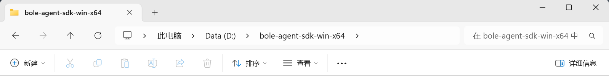
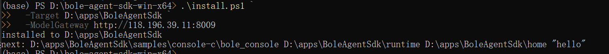
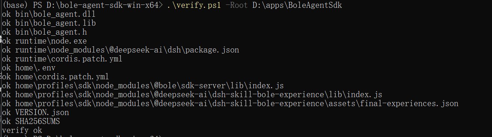
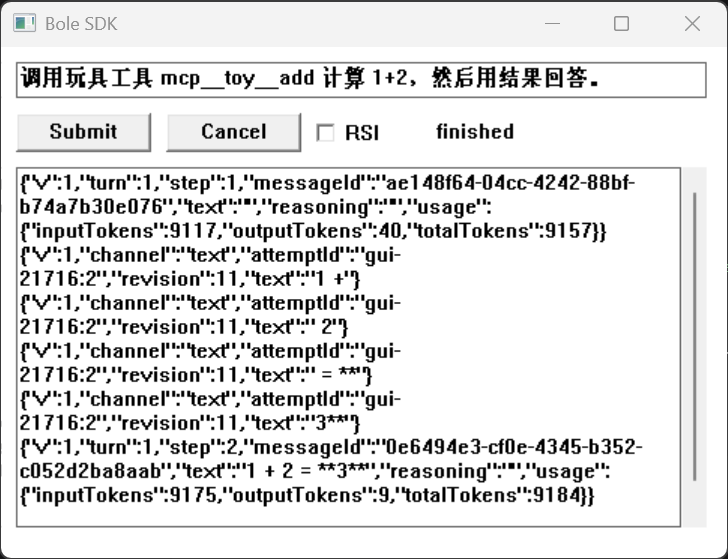
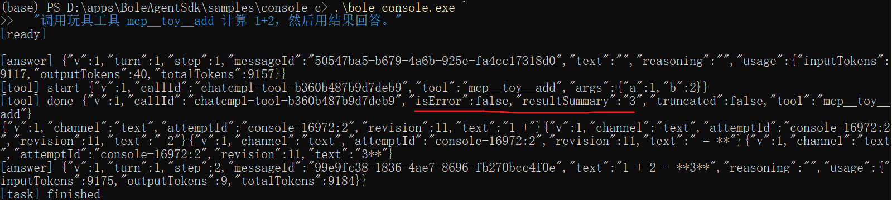
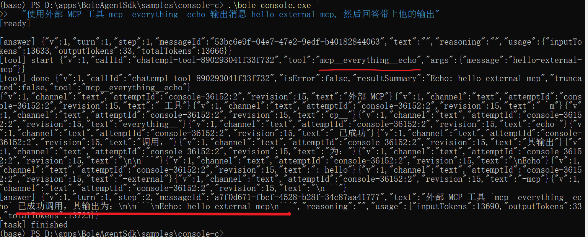
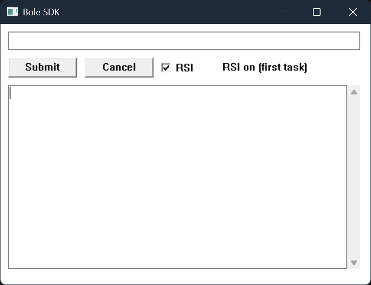

# 伯乐 Agent SDK 使用说明

本文只说明怎么把 SDK 跑起来。按顺序做 5 步即可；第 6 章是两个 MCP 工具示例；新增/安装步骤在独立文档中。

## 第 1 步：解压

把 `bole-offline-r6-final.zip` 解压到一个目录，例如：

```text
D:\bole-agent-sdk-win-x64
```

解压后应能看到：

```text
bin\        SDK 的 dll/lib/头文件
runtime\    随包运行时
samples\    控制台和界面示例
tools\      玩具 MCP
install.ps1
verify.ps1
```



## 第 2 步：安装

打开 PowerShell，进入解压目录：

```powershell
cd D:\bole-agent-sdk-win-x64

.\install.ps1 `
  -Target D:\apps\BoleAgentSdk `
  -ModelGateway http://192.168.19.203:9001
```

说明：

- `-Target` 是 SDK 的安装目录，**不要填解压目录**；
- 不需要管理员权限，不会写注册表。

成功会显示：

```text
installed to D:\apps\BoleAgentSdk
```



## 第 3 步：检查

```powershell
.\verify.ps1 -Root D:\apps\BoleAgentSdk
```

最后一行应为：

```text
verify ok
```



## 第 4 步：运行示例

### 方式 A：控制台

```powershell
cd D:\apps\BoleAgentSdk\samples\console-c

.\bole_console.exe "你好"
```

看到 `[answer]` 和 `[task] finished` 就表示正常运行。

```powershell
.\bole_console.exe `
  "调用玩具工具 mcp__toy__add 计算 1+2，然后用结果回答。"
```

应看到工具调用和结果 `3`。

### 方式 B：界面

```powershell
cd D:\apps\BoleAgentSdk\samples\gui-win32

.\bole_gui.exe
```

在输入框输入：

```text
调用玩具工具 mcp__toy__add 计算 1+2，然后用结果回答。
```

点 **Submit**，状态变为 `finished` 即成功。



需要 RSI 时，勾选界面上的 **RSI** 再提交；控制台对应参数是 `--rsi`。

## 第 5 步：接入自己的程序

1. 把 `bin\bole_agent.h` 加入 include；
2. 链接 `bin\bole_agent.lib`；
3. 运行时可执行文件同目录放 `bole_agent.dll`；
4. 按 `docs/02-integration.md` 的示例调用。

更完整的接口、错误码和部署说明在包内 `docs/`。

## 第 6 章：MCP 工具示例

### 6.1 示例一：调用自带的 12 个工具

SDK 安装包内已经带了一个玩具 MCP，注册了 12 个工具：

```text
add, subtract, multiply, echo, now, word_count,
sha256, json_get, uuid, sleep, big_text, fail
```

选一个有代表性的 `mcp__toy__add` 做截图即可：

```powershell
cd D:\apps\BoleAgentSdk\samples\console-c

.\bole_console.exe `
  "调用玩具工具 mcp__toy__add 计算 1+2，然后用结果回答。"
```

输出中应出现：

```text
[tool] start ... "tool":"mcp__toy__add","args":{"a":1,"b":2}
[tool] done  ... "isError":false,"resultSummary":"3"
[task] finished
```



如果需要证明 12 个工具都已注册：

```powershell
D:\apps\BoleAgentSdk\runtime\node.exe `
  D:\apps\BoleAgentSdk\tools\toy-mcp\smoke.mjs
```

期望：

```text
PASS toy MCP: 12 tools
```

### 6.2 示例二：调用外部开源 MCP 服务

本示例使用官方开源的 **Everything Server**：

- 文档：<https://modelcontextprotocol.io/examples>
- 源码：<https://github.com/modelcontextprotocol/servers/tree/main/src/everything>
- npm 包：`@modelcontextprotocol/server-everything@2.0.0`

它是独立于 SDK 的第三方 MCP 进程，免费、开源，通过 stdio 接入。

安装和接入步骤见《MCP 工具接入与示例》（随客户版压缩包一起提供，
`05-mcp-integration.md`）。按该文档安装、配置并重启运行时后，再执行：

```powershell
cd D:\apps\BoleAgentSdk\samples\console-c

.\bole_console.exe `
  "使用外部 MCP 工具 mcp__everything__echo 输出消息 hello-external-mcp, 然后回答带上他的输出"
```



> 新增其他 MCP 服务、安装外部 MCP 服务：见《MCP 工具接入与示例》
> （`05-mcp-integration.md`）。

## 第 7 章：RSI 使用说明

### 开启后的效果

开启 RSI 后，新建会话会加载对应模型的服务经验：

- 普通问答：回答会参考该模型的经验，事件里会看到经验可用；
- 服务生命周期类任务：会写入/投递经验，返回 `delivered`，并带上经验 ID；
- 不开启：普通 `standard` 模式，不加载、不投递经验；
- 模型不在经验列表：返回 `unsupported-model`，不会投递经验。

RSI 只影响**新建会话**。已经开始的对话/任务不会中途切换；默认关闭。

### 在界面中开启

1. 启动 `bole_gui.exe`；
2. 勾选 **RSI**；
3. 再点 **Submit**。

状态栏会显示类似：

```text
RSI on (first task)
```

之后这个会话的回答会使用经验。一个任务结束后再提交，GUI 可能新建会话，RSI 继续作为新会话的默认值。



### 在控制台中开启

```powershell
cd D:\apps\BoleAgentSdk\samples\console-c

.\bole_console.exe --rsi "你好"
```

开启后会打印：

```text
RSI: on
```

关闭：

```powershell
.\bole_console.exe --rsi=off "你好"
```

不加参数就是默认的普通模式。

### 在 C 代码中开启

初始化时设置新会话默认值：

```c
bole_config cfg = {0};
cfg.size = sizeof(cfg);
cfg.rsi_enabled = 1;
```

运行时修改：

```c
bole_rsi_set(handle, 1);   /* 1=开启，0=关闭 */
```

指定某个空白会话：

```c
bole_session_set_preset(session, "rsi-infer");
```

### 生效范围

| 操作 | 效果 |
| --- | --- |
| 新会话普通提问 | 回答参考经验，返回 `available` |
| 新会话服务生命周期任务 | 经验投递，返回 `delivered` 和经验 ID |
| 不开启 RSI | `standard`，没有经验投递 |
| 模型不在允许列表 | `unsupported-model`，不投递 |
| 任务开始后再切换 | 返回 `PRESET_LOCKED`（4003），本次任务不变 |

### 注意

- 在第一次 Submit 前决定是否开启；
- 经验只对 `qwen3.8-27b` / `Ornith-1.5-35B-A3B` 生效；
- RSI 与 MCP 工具互不影响，开不开 RSI 都可以调用 MCP 工具；
- 控制台不打印经验收据，需要看效果时用 GUI 或 `bole_selfcheck.exe`。

## 常见问题

**Q：`[ready]` 后一直等到 `timeout waiting for the task`？**

`[ready]` 表示 SDK 和本地运行时已经启动。此时通常是模型网关未返回结果，请联系部署方确认网关和模型服务。

**Q：提示 `failed to import @bole/sdk-server`？**

没有走 `install.ps1`，或安装目录的 `home\profiles\sdk\node_modules` 不完整。重新执行第 2 步。

**Q：玩具工具不出现？**

确认 `home\cordis.patch.yml` 已由 `install.ps1` 生成；新增 MCP 工具需要修改该文件并重启运行时。

## 说明

- 支持 Windows 10 / 11 x64。
- 本版本不产生“验证阶段”事件；任务是否结束以 `TASK_FINISHED` / `TASK_FAILED` 为准。
- MCP 工具只支持配置文件声明 + 重启，不支持运行时注册。
